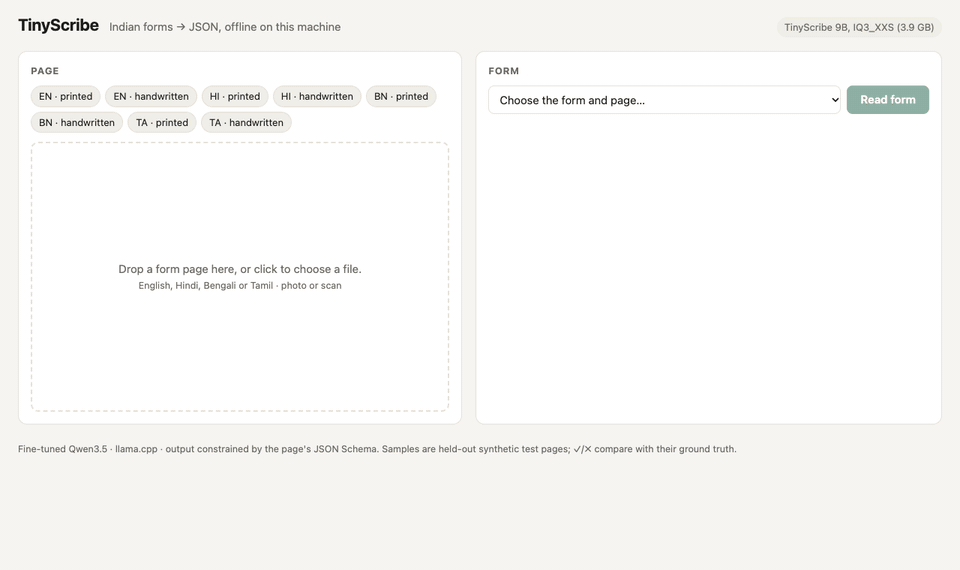

# TinyScribe

Read filled Indian forms (English, Hindi, Bengali, Tamil; printed or handwritten) into JSON, offline on a laptop.

TinyScribe fine-tunes Qwen3.5-9B on synthetic filled government forms, quantizes it to a 3.9 GB GGUF (4.5 GB with its vision projector) and runs it with llama.cpp on a 16 GB MacBook Pro M4. The output always matches the page's JSON Schema.



## Results

401 held-out test pages (ECI Form 7 and a job application, never seen in training, in all four scripts, half handwritten, four degradation levels). Field F1 is exact match after normalization. Accuracy from llama.cpp on the DGX; speed and memory on a MacBook Pro M4, 16 GB, with the same weights and engine.

| Model | Size | Field F1 | English | Hindi | Tamil | Bengali | Valid JSON | s / page (Metal) | s / page (CPU) | Peak memory |
|---|---|---|---|---|---|---|---|---|---|---|
| 9B zero-shot, BF16 | 18.41 GB | 81.2 | 90.6 | 72.7 | 78.5 | 81.9 | 100.0 | | | |
| 2B zero-shot, BF16 | 3.90 GB | 64.9 | 82.2 | 55.5 | 57.2 | 62.5 | 100.0 | | | |
| 9B fine-tuned, BF16 | 18.41 GB | 88.6 | 95.5 | 83.4 | 85.4 | 89.0 | 100.0 | | | |
| 9B fine-tuned, Q4_K_M (over budget, reference) | 5.71 GB | 88.5 | 95.6 | 83.3 | 84.8 | 89.2 | 100.0 | 36.5 | 99.3 | 7.99 GB |
| **9B fine-tuned, IQ3_XXS** | **3.89 GB** | **86.5** | 95.1 | 81.6 | 80.6 | 87.0 | 100.0 | **33.2** | 107.2 | **6.29 GB** |
| 9B fine-tuned, IQ2_M | 3.69 GB | 84.3 | 94.6 | 79.1 | 76.1 | 85.1 | 100.0 | 33.8 | 110.7 | 6.10 GB |
| 9B fine-tuned, IQ2_XXS | 3.18 GB | 72.9 | 92.1 | 69.5 | 52.6 | 71.7 | 100.0 | | | |
| **2B fine-tuned, Q8_0** | **2.03 GB** | **84.0** | 93.5 | 80.3 | 79.2 | 81.3 | 100.0 | **14.5** | 39.5 | **3.49 GB** |

Quants use the form-text importance matrix and the Q8_0 vision projector (0.62 GB for the 9B, 0.36 GB for the 2B; Size is the language model alone). Peak memory = model + projector + llama-server's peak working memory. Every row with both imatrices, Q3_K_S and the 2B BF16: [Week 3 report](docs/reports/week-3.md).

- **Fine-tuning:** 9B 81.2 → 88.6, 2B 64.9 → 83.8. The 9B's gain is concentrated on the harder layout (ECI Form 7: 68.1 → 88.8) and Hindi handwriting (54.7 → 69.0).
- **Quantization:** IQ3_XXS keeps 97.6% of the full-precision 9B's field F1 at 21% of its size, about 33 s per page on the M4's GPU. Below 3 bits accuracy falls off fast (IQ2_XXS: 72.9, Tamil 52.6).
- **Same budget, smaller model:** inside 4 GB the quantized 9B beats the 8-bit 2B by 2.5 points, at 2.3× the time per page.
- **Form vs generic importance matrix:** no real difference (≤ 1 point either way). Both are text-only; see [LIMITATIONS.md](LIMITATIONS.md).
- **Hardest case:** Hindi handwriting, 67.3 for the IQ3_XXS model; English printed is 99.9.

## Use it

Needs macOS on Apple Silicon (or Linux), Python 3.11, [uv](https://docs.astral.sh/uv/), cmake.

```bash
git clone https://github.com/hemish22/TinyScribe && cd TinyScribe
uv venv --python 3.11 && uv pip install -e . && source .venv/bin/activate
make llama                       # llama.cpp at the pinned commit (Metal on macOS, CUDA on Linux)
```

Download the models from Hugging Face, [hemish22/TinyScribe-GGUF](https://huggingface.co/hemish22/TinyScribe-GGUF) (6.9 GB: 9B IQ3_XXS, 2B Q8_0 and their Q8_0 vision projectors; non-commercial research use):

```bash
hf download hemish22/TinyScribe-GGUF --local-dir models/TinyScribe-GGUF
```

**Command line.** Pick the form page with `--schema` (`tinyscribe schemas` lists all 53):

```bash
tinyscribe parse form.jpg --schema eci_form7_hi_p0                # JSON to stdout
tinyscribe parse form.jpg --schema eci_form7_hi_p0 --labels       # printed label + value per line
tinyscribe parse p1.jpg p2.jpg --schema synth_job_application_ta_p0 --model 2b -o out.jsonl
```

A Hindi ECI Form 7 test page, 9B IQ3_XXS, 36 s (first keys shown):

```json
{
  "fields": {"f_name_applicant": "नेहा नायर", "f_epic": "TEST-6232", "f_mobile_self": "9883221628",
             "f_mobile_relative": "9934184643", "...": "..."},
  "checkboxes": {"cb_del_root": false, "cb_del_death": false, "cb_del_under_age": true, "...": false}
}
```

**Web demo.** `make demo` (or `MODEL_NAME=2b make demo`) opens http://127.0.0.1:8000: drop a page, pick its form, read it. With the test set present (`data/`), sample pages show ✓/✗ against their ground truth. Nothing leaves the machine.

Any photo or scan is resized to the 1536 px long side the model trained on. Each page runs once through llama-server's OpenAI-style API with the image, a prompt listing the page's fields by their printed labels, and a JSON-Schema grammar, so the output is always valid JSON with exactly the page's keys.

## How it was built

1. **Data** (`datagen/`). 30 form templates in four scripts, annotated with field boxes: 22 real government forms (Election Commission of India Forms 6, 6A, 6B, 7, 8; Atal Pension Yojana; RTI appeals; TN ICDS; WB Bangla Sahayata Kendra) and 8 synthetic household and job-application forms. A generator fills them with script-correct values (shaped with HarfBuzz/raqm), pastes real handwriting crops (EMNIST, IIIT-INDIC-HW-WORDS Hindi and Tamil, BanglaWriting) into about half the pages, ticks checkboxes and degrades the page at four levels. 10,411 pages; test = two whole form types held out across all scripts.
2. **Fine-tune** (`train/`). Unsloth bf16 LoRA (r = 16) on the language model of Qwen3.5-9B and 2B, vision encoder frozen, thinking off, one epoch, one A100 40 GB each.
3. **Quantize** (`quant/`). Merge, convert to GGUF, build two importance matrices (form text vs WikiText-2), sweep Q4_K_M, Q3_K_S, IQ3_XXS, IQ2_M, IQ2_XXS. IQ3_XXS fits under 4.0 GB with a q4_K output tensor.
4. **Score** (`eval/`). Every model, zero-shot included, through the same llama-server request on the DGX, four GPUs in parallel.
5. **Time** (`bench/`). Same request on the Mac: Metal and CPU-only, peak memory from macOS's `footprint`.

Weekly progress with every decision and number: [docs/reports](docs/reports/). Plan: [v5](docs/TinyScribe%20—%204-Week%20Resume%20Project_v5.md).

## Reproduce

Each step is one `make` target (DGX steps queue in tmux and wait for a free GPU):

| Step | Where | Command |
|---|---|---|
| Build the dataset | DGX or Mac | `make data` |
| Fine-tune | DGX | `make train SIZE=9b` |
| Train → merge → score → quantize → score, queued | DGX | `make pipeline SIZE=9b` |
| Importance matrices + quant grid | DGX | `make quantize` |
| Score a model | DGX | `make serve MODEL=… MMPROJ=…` then `make eval NAME=…` |
| Results table | anywhere | `make table` |
| Speed and memory | Mac | `make bench BENCH_RUN=… BENCH_MODEL=… BENCH_MMPROJ=…` |
| Tests | anywhere | `make test` |

## Limitations

Synthetic test pages, four scripts, Bengali and Tamil handwriting partly drawn in a handwriting font, text-only importance matrices, one MacBook for timing, non-commercial data licences. Details: [LIMITATIONS.md](LIMITATIONS.md).

## Licence

Code: Apache-2.0 (as declared in `pyproject.toml`). Trained models inherit the non-commercial terms of BanglaWriting (CC BY-NC 3.0) and IIIT-INDIC-HW-WORDS (research use). Qwen3.5: Apache-2.0.
